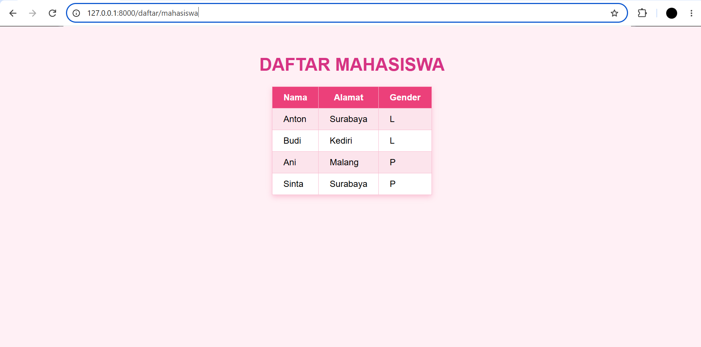
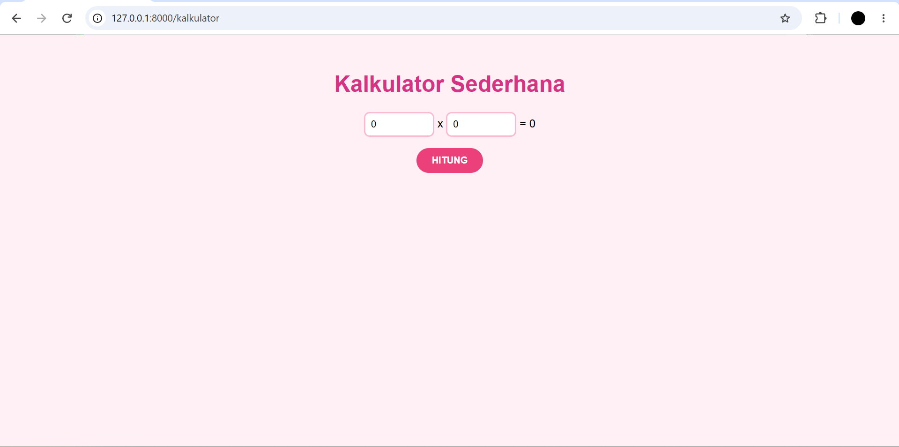
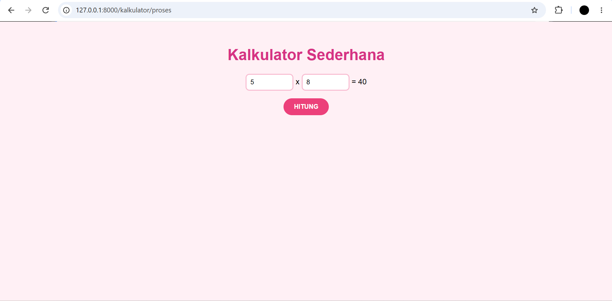
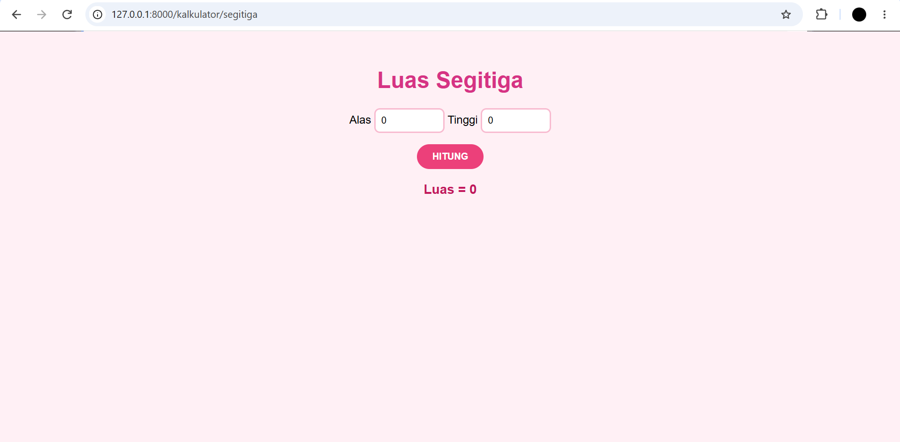
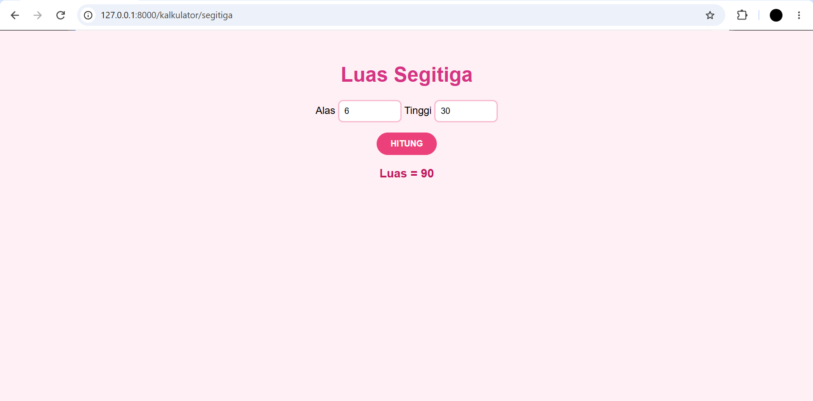

# Tugas Praktikum Framework Laravel

Project latihan dari **Modul Praktikum Framework Laravel** (penyusun Rudy Eko Prasetya, S.Kom).

| | |
|---|---|
| **Nama** | Armelia Dwi Prastyawati |
| **Asal** | Nganjuk |
| **GitHub** | [armeliadwi25-code](https://github.com/armeliadwi25-code) |
| **Repository** | https://github.com/armeliadwi25-code/laravel-2a |
| **Framework** | Laravel 13 (PHP 8.3 ke atas) |

## Deskripsi

Project ini adalah hasil praktikum Framework Laravel yang mengikuti Modul Praktikum Framework Laravel. Tujuannya mempelajari dasar pembuatan aplikasi web dengan Laravel yang menerapkan konsep **MVC (Model-View-Controller)**.

Yang dipelajari dan dipraktikkan:

- **Route:** mengatur URL yang bisa diakses, termasuk route dengan parameter (`/profil/{nama}`) dan route GET/POST.
- **Controller:** memisahkan logika program dari route (`Web`, `KalkulatorController`, `MahasiswaController`).
- **View (Blade):** menampilkan halaman HTML dengan data dari controller, memakai `{{ }}`, `@foreach`, dan `@csrf`.
- **Parsing data:** mengirim data dari controller ke view dan menangkap input form lewat `Request`.
- **CSS:** mempercantik tampilan dengan tema pink dari `public/css/style.css`.

## Materi yang Dikerjakan

1. Route dan Controller
2. Parsing data ke View (Blade)
3. Latihan MahasiswaController
4. Latihan kalkulator luas segitiga
5. Latihan CSS (tema pink)

## Daftar Route

| Method | URL | Tujuan |
|---|---|---|
| GET | `/` | Teks sambutan (closure) |
| GET | `/about` | Halaman About (closure) |
| GET | `/web` | `Web@home` |
| GET | `/profil/{nama}` | `Web@profil`, menerima nama dari URL |
| GET | `/biodata` | `Web@biodata`, menampilkan view `biodata` |
| GET | `/kalkulator` | `KalkulatorController@home`, form perkalian |
| POST | `/kalkulator/proses` | `KalkulatorController@proses`, hitung perkalian |
| GET | `/kalkulator/segitiga` | `KalkulatorController@segitiga`, form luas segitiga |
| POST | `/kalkulator/segitiga` | `KalkulatorController@hitungSegitiga`, hitung luas |
| GET | `/daftar/mahasiswa` | `MahasiswaController@index`, tabel mahasiswa |

## Deskripsi Aplikasi

Aplikasi yang dibuat terdiri dari empat halaman web sederhana. Semuanya berjalan lokal dengan `php artisan serve`.

### 1. Kalkulator Perkalian
Halaman untuk mengalikan dua angka.
- Pengguna mengisi dua kolom angka, lalu menekan tombol **HITUNG**.
- Data dikirim lewat form (metode POST) ke `KalkulatorController@proses`.
- Controller mengalikan kedua angka, lalu hasilnya ditampilkan kembali di halaman yang sama.
- Angka yang sudah diisi tetap muncul di kolom setelah dihitung.

### 2. Kalkulator Luas Segitiga
Halaman untuk menghitung luas segitiga.
- Pengguna mengisi **alas** dan **tinggi**, lalu menekan **HITUNG**.
- Controller menghitung dengan rumus `1/2 x alas x tinggi`.
- Hasil ditampilkan sebagai teks **Luas = ...** di bawah tombol.
- Memakai controller yang sama dengan kalkulator perkalian (`KalkulatorController`).

### 3. Daftar Mahasiswa
Halaman yang menampilkan data mahasiswa dalam bentuk tabel (Nama, Alamat, Gender).
- Data disimpan sebagai array di `MahasiswaController@index`, berisi 4 mahasiswa: Anton, Budi, Ani, dan Sinta.
- View menampilkan tiap baris tabel dengan perulangan `@foreach`.
- Tabel memakai warna header pink dan baris selang-seling.

### 4. Halaman Pendukung
Halaman latihan dasar route dan controller:
- `/web` menampilkan teks dari controller `Web`.
- `/profil/{nama}` menampilkan nama yang diketik di URL, misalnya `/profil/armelia`.
- `/biodata` menampilkan biodata (nama dan alamat) dari controller ke view `biodata`.

### Tampilan
Semua halaman memakai satu file CSS (`public/css/style.css`) bertema pink: latar pink muda, judul pink tua, tombol bulat, dan tabel dengan header berwarna.

## Hasil Tugas

### 1. Daftar Mahasiswa (`/daftar/mahasiswa`)

Data mahasiswa dikirim dari `MahasiswaController` ke view `mahasiswa.blade.php`, lalu ditampilkan dengan `@foreach`.



### 2. Kalkulator Sederhana (`/kalkulator`)

Tampilan awal form perkalian.



Setelah tombol **HITUNG** ditekan (`/kalkulator/proses`), contoh 5 x 8 = 40.



### 3. Luas Segitiga (`/kalkulator/segitiga`)

Tampilan awal form luas segitiga.



Rumus yang dipakai: luas = 1/2 x alas x tinggi. Contoh alas 6 dan tinggi 30 menghasilkan luas 90.



## Struktur File yang Dibuat

```
app/Http/Controllers/
  Web.php
  KalkulatorController.php
  MahasiswaController.php
resources/views/
  biodata.blade.php
  kalkulator.blade.php
  segitiga.blade.php
  mahasiswa.blade.php
routes/web.php
public/css/style.css
screenshot/
```

## Cara Menjalankan

1. Clone repository:
   ```bash
   git clone https://github.com/armeliadwi25-code/laravel-2a.git
   cd laravel-2a
   ```
2. Pasang dependency:
   ```bash
   composer install
   ```
3. Salin file environment lalu buat key (Windows):
   ```bash
   copy .env.example .env
   php artisan key:generate
   ```
4. Jalankan server:
   ```bash
   php artisan serve
   ```
5. Buka `http://127.0.0.1:8000` di browser.

---

<p align="center"><a href="https://laravel.com" target="_blank"></a></p>

<p align="center">
<a href="https://github.com/laravel/framework/actions"></a>
<a href="https://packagist.org/packages/laravel/framework"></a>
<a href="https://packagist.org/packages/laravel/framework"></a>
<a href="https://packagist.org/packages/laravel/framework"></a>
</p>

## About Laravel

Laravel is a web application framework with expressive, elegant syntax. We believe development must be an enjoyable and creative experience to be truly fulfilling. Laravel takes the pain out of development by easing common tasks used in many web projects, such as:

- [Simple, fast routing engine](https://laravel.com/docs/routing).
- [Powerful dependency injection container](https://laravel.com/docs/container).
- Multiple back-ends for [session](https://laravel.com/docs/session) and [cache](https://laravel.com/docs/cache) storage.
- Expressive, intuitive [database ORM](https://laravel.com/docs/eloquent).
- Database agnostic [schema migrations](https://laravel.com/docs/migrations).
- [Robust background job processing](https://laravel.com/docs/queues).
- [Real-time event broadcasting](https://laravel.com/docs/broadcasting).

Laravel is accessible, powerful, and provides tools required for large, robust applications.

## Learning Laravel

Laravel has the most extensive and thorough [documentation](https://laravel.com/docs) and video tutorial library of all modern web application frameworks, making it a breeze to get started with the framework.

In addition, [Laracasts](https://laracasts.com) contains thousands of video tutorials on a range of topics including Laravel, modern PHP, unit testing, and JavaScript. Boost your skills by digging into our comprehensive video library.

You can also watch bite-sized lessons with real-world projects on [Laravel Learn](https://laravel.com/learn), where you will be guided through building a Laravel application from scratch while learning PHP fundamentals.

## Agentic Development

Laravel's predictable structure and conventions make it ideal for AI coding agents like Claude Code, Cursor, and GitHub Copilot. Install [Laravel Boost](https://laravel.com/docs/ai) to supercharge your AI workflow:

```bash
composer require laravel/boost --dev

php artisan boost:install
```

Boost provides your agent 15+ tools and skills that help agents build Laravel applications while following best practices.

## Contributing

Thank you for considering contributing to the Laravel framework! The contribution guide can be found in the [Laravel documentation](https://laravel.com/docs/contributions).

## Code of Conduct

In order to ensure that the Laravel community is welcoming to all, please review and abide by the [Code of Conduct](https://laravel.com/docs/contributions#code-of-conduct).

## Security Vulnerabilities

If you discover a security vulnerability within Laravel, please send an e-mail to Taylor Otwell via [taylor@laravel.com](mailto:taylor@laravel.com). All security vulnerabilities will be promptly addressed.

## License

The Laravel framework is open-sourced software licensed under the [MIT license](https://opensource.org/licenses/MIT).
